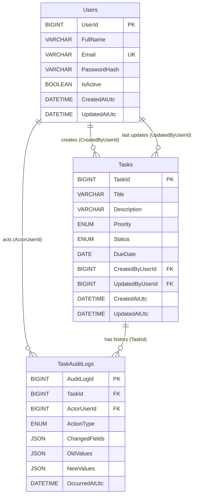

# Team Task Tracker - ERD and Relationship Rules

## Why three tables

| Table | Question it answers | Why it cannot be merged |
|---|---|---|
| `Users` | Who is acting? | Identity must be unique and reusable across tasks and audit rows. |
| `Tasks` | What is the current state? | One row per task; editing it destroys the previous state. |
| `TaskAuditLogs` | What happened before? | Append-only history must survive edits and task deletion. |

A single `Tasks` table can show the present, but it cannot reconstruct the
sequence of past changes. The audit table is the history; the task table is the
present.

## ERD

## Relationships in plain language

1. **One user creates many tasks.** `Tasks.CreatedByUserId` is required and
   points to `Users.UserId`. `ON DELETE RESTRICT` means you cannot delete a user
   who still owns tasks, preserving attribution.
2. **One user last updated many tasks.** `Tasks.UpdatedByUserId` is nullable
   until the first edit. `ON DELETE SET NULL` keeps the task if that user is
   removed, without inventing a false editor.
3. **One user generates many audit events.** `TaskAuditLogs.ActorUserId` is
   required. `ON DELETE RESTRICT` protects the audit trail from losing its actor.
4. **One task has many audit events.** `TaskAuditLogs.TaskId` is nullable.
   `ON DELETE SET NULL` is what lets a deleted task keep its history: the audit
   row survives with `TaskId = NULL`.

## Indexes and why they exist

| Index | Supports |
|---|---|
| `UQ_Users_Email` | Login lookup and prevention of duplicate accounts. |
| `IX_Tasks_Status_DueDate` | Filtering by status and urgency-first ordering. |
| `IX_Tasks_CreatedByUserId` | "Tasks I created" and creator joins. |
| `IX_Tasks_UpdatedByUserId` | "Tasks I last edited" and editor joins. |
| `IX_TaskAuditLogs_TaskId_OccurredAtUtc` | Task history in time order. |
| `IX_TaskAuditLogs_ActorUserId_OccurredAtUtc` | "What did this user do?" in time order. |

## Integrity rules enforced by the database

- `Email` is unique and nonblank.
- `FullName` and `Title` cannot be blank after trimming.
- `Priority` only allows `Low`, `Medium`, `High`.
- `Status` only allows `ToDo`, `InProgress`, `Done`.
- Every task has a real creator.
- Every audit event has a real actor.
- Deleting a task preserves its audit rows with a null `TaskId`.
